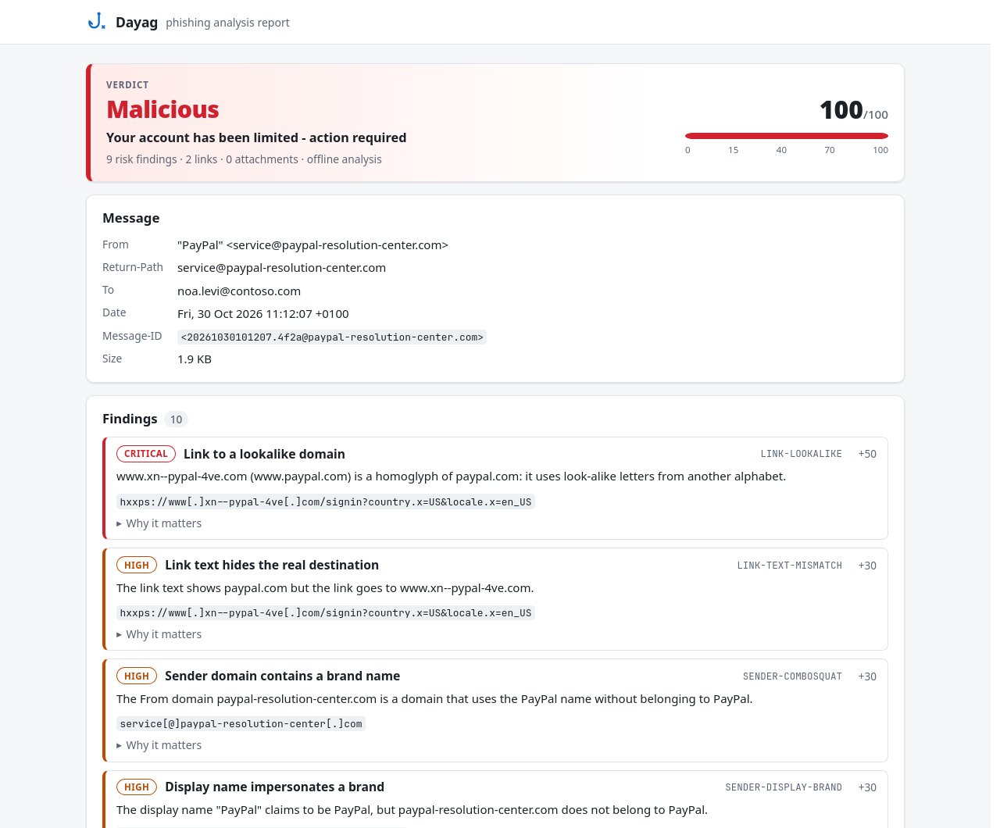
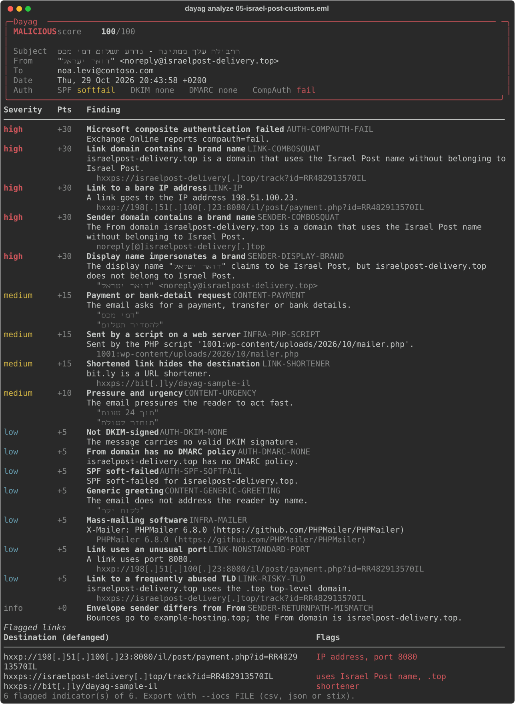
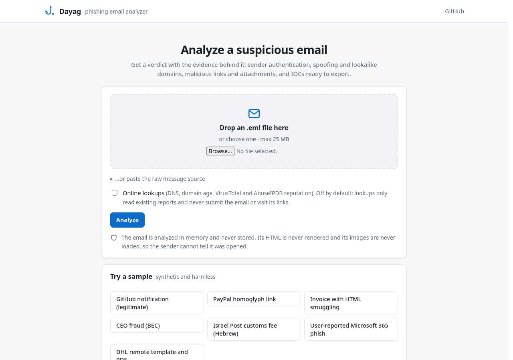
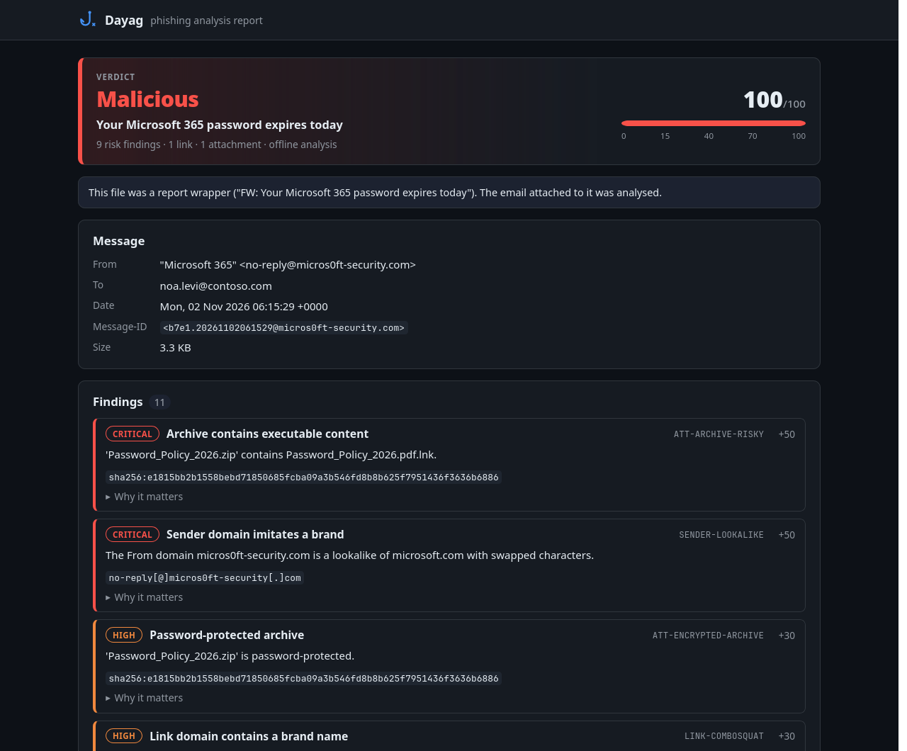

<div align="center">


# Dayag · דייג

**A phishing email analyzer for SOC analysts.**
Drop in a suspicious email, get a verdict with the evidence behind it, and export the IOCs.

[](https://github.com/harelhz/dayag/actions/workflows/ci.yml)
[](LICENSE)


</div>

---

_Dayag_ (Hebrew: דייג, "fisherman") does the first ten minutes of a phishing investigation: the work
a Tier-1 analyst repeats for every email a user reports. It reads the headers, checks who really
sent the email, takes the links and attachments apart without opening them, and explains every
finding in plain language with its MITRE ATT&CK technique.

<p align="center">
  
</p>

## What it detects

| Area | Checks |
| --- | --- |
| **Authentication** | SPF, DKIM, DMARC and Microsoft CompAuth as recorded by the receiving server. Trusts only the receiving server's header and flags **forged `Authentication-Results`** inserted by the sender. Falls back to ARC for forwarded mail. |
| **Sender** | **Lookalike domains**: homoglyphs (`pаypal.com` with a Cyrillic `а`), swapped characters (`micros0ft`, `rnicrosoft`), typos, TLD swaps and brand names (`paypal-support.com`). **Display-name impersonation** (`"PayPal" <x@evil>`, including Hebrew names such as `דואר ישראל`), **Reply-To diversion** (business email compromise), free-mail senders. |
| **Links** | **Unwraps Microsoft Safe Links, Proofpoint URL Defense and Google redirects** to reveal the real destination. Finds lookalikes, **link text that hides the real target**, bare IPs, the `@` trick, shorteners, free hosting, IPFS, risky TLDs and `javascript:`/`data:` links. Also scans links inside HTML, PDF and Office attachments. |
| **Attachments** | True file type from magic bytes. Double extensions, **right-to-left override** names, executables, disk images (Mark-of-the-Web bypass), **HTML smuggling**, VBA macros (OOXML and OLE), **remote template injection**, password-protected archives and what is inside them, OneNote, and PDF JavaScript, launch actions and embedded files (including compressed streams). |
| **Content** | Urgency, credential, payment/BEC and gift-card language **in English and Hebrew**, resistant to zero-width-character tricks. Fake `RE:`/`FW:` threads, forms and password fields in the body, hidden text, image-only emails (QR-code phishing). |
| **Infrastructure** | Mail path with per-hop delays and the originating IP, mail sent by PHP scripts on hacked websites, mass-mailing tools. |
| **Online, opt-in** | Domain age (RDAP), live DMARC/MX (DNS), VirusTotal reputation of files, URLs and domains, AbuseIPDB reputation of the sending IP. |

All **70 rules** are listed with their scores and ATT&CK mappings in [docs/DETECTIONS.md](docs/DETECTIONS.md). That page is generated from the code, so it cannot drift.

It also handles a real SOC quirk: when users report phishing by forwarding it **as an
attachment**, Dayag unwraps the forward and analyzes the original.

## Quick start

```bash
git clone https://github.com/harelhz/dayag && cd dayag
python -m venv .venv && source .venv/bin/activate
pip install -e ".[web]"

dayag samples                                              # 7 bundled samples and their verdicts
dayag analyze src/dayag/samples/02-paypal-homoglyph.eml    # analyze one email
dayag serve                                                # web UI on http://127.0.0.1:8000
```

Or with Docker:

```bash
docker build -t dayag .
docker run --rm -p 127.0.0.1:8000:8000 dayag
```

## Usage

<p align="center">
  
</p>

```bash
# Full report in the terminal (-v adds every link and the mail path)
dayag analyze suspicious.eml

# A standalone HTML report to attach to the ticket, and the IOCs for the SIEM or TIP
dayag analyze suspicious.eml --html report.html --iocs iocs.csv
dayag analyze suspicious.eml --iocs bundle.json --ioc-format stix     # STIX 2.1

# Triage a folder of user reports; exit code 1 if anything is likely phishing
dayag analyze reported/*.eml --fail-on likely_phishing

# Machine-readable output
dayag analyze suspicious.eml --json | jq '.verdict, .findings[].id'

# Online enrichment (RDAP and DNS need no keys)
export DAYAG_VIRUSTOTAL_KEY=...   DAYAG_ABUSEIPDB_KEY=...
dayag analyze suspicious.eml --online

# Trust only Authentication-Results written by your own mail servers (not for Exchange
# Online, whose headers carry no authserv-id)
export DAYAG_TRUSTED_AUTHSERV=mx.contoso.com
```

The web UI has the same analysis with drag-and-drop, sample emails and one-click downloads of the
HTML report, JSON, CSV and STIX. It also has a JSON API for SOAR playbooks:

```bash
curl --data-binary @suspicious.eml -H "Content-Type: message/rfc822" \
     "http://127.0.0.1:8000/api/analyze?online=false"
```

<p align="center">
  
  
</p>

## How the verdict is reached

```
.eml ─▶ parse ─▶ extract facts ─▶ 6 offline checks ─▶ (online lookups) ─▶ score ─▶ report
         │          │                  │
         │          │                  └─ judgements: each finding cites a rule from rules.py
         │          └─ headers, auth results, hops, links (unwrapped), attachments (sniffed, listed)
         └─ raw headers decoded by hand: malformed headers never crash the parser
```

Every rule has a fixed number of points (−10 to +50). The score is the sum, **counting each rule
once** however many times it fires (ten shortened links are one indicator, not ten), clamped to
0-100:

| Score | Verdict |
| --- | --- |
| 70-100 | Malicious |
| 40-69 | Likely phishing |
| 15-39 | Suspicious |
| 0-14 | No strong indicators |

A passing DMARC check subtracts 10 points. It proves the email came from that domain, **not that
the domain is trustworthy**: attackers authenticate their own lookalike domains. In the PayPal
sample DMARC passes, and the email still scores 100.

## Built to be safe on hostile input

The email under analysis is written by an attacker, so the analyzer assumes nothing about it.

- **Offline by default.** Analysis makes no network requests unless you pass `--online`.
- **Never tips off the sender.** HTML is never rendered and remote images are never loaded, so
  tracking pixels don't fire. Links are never visited.
- **Never leaks the email.** Online lookups only *read* existing reports (hashes, domains, URL
  IDs); nothing is uploaded or submitted to VirusTotal.
- **Safe reports.** HTML reports escape everything, show links as defanged text, and carry a
  Content-Security-Policy that blocks scripts and remote content. Terminal output strips escape
  sequences and never interprets email text as markup.
- **Bounded work.** Archives are listed from the central directory, never extracted. Decompression
  (Office files, PDF streams) is size-capped against zip and PDF bombs. Emails are capped at 25 MB.
- **Stateless web UI.** Uploads are analyzed in memory and discarded. Downloads are embedded in
  the page, so nothing is written to disk. The server binds to localhost by default and sends a
  strict CSP.

See [SECURITY.md](SECURITY.md) for the threat model and [docs/ARCHITECTURE.md](docs/ARCHITECTURE.md)
for the design decisions.

## Samples

Seven synthetic, harmless samples ([how they are made](scripts/make_samples.py)) cover the main
phishing families:

| Sample | Verdict | What it demonstrates |
| --- | --- | --- |
| GitHub notification | No strong indicators | A legitimate email: auth passes, links match the sender |
| PayPal homoglyph link | Malicious | Cyrillic lookalike domain behind link text that shows `paypal.com` |
| Invoice with HTML smuggling | Malicious | `INV-20931.pdf.html` builds a file in the browser; fake `RE:` thread |
| CEO fraud (BEC) | Likely phishing | No links or attachments: Reply-To diversion and wire-transfer pressure |
| Israel Post customs fee | Malicious | Hebrew content, compromised WordPress server, IP link on port 8080 |
| User-reported Microsoft 365 phish | Malicious | Report wrapper, Safe Links, `micros0ft`, encrypted zip with a `.pdf.lnk` |
| DHL shipping documents | Malicious | Remote template injection in a .docx, PDF JavaScript, forged auth header |

## Project layout

```
src/dayag/
  analyzer.py        the pipeline
  parsing.py         raw bytes -> headers, bodies, attachments
  headers.py         Received chain and Authentication-Results parsing
  context.py         facts extracted once and shared by all checks
  checks/            judgements: auth, sender, links, attachments, content, infrastructure
  rules.py           every rule: severity, points, ATT&CK, rationale (single source of truth)
  domains.py         registrable domains, lookalike detection, defanging
  filetypes.py       magic-byte sniffing, archive, Office, PDF and HTML inspection
  knowledge.py       brands, free-mail, shorteners, risky TLDs, phrases (English and Hebrew)
  enrich/            opt-in RDAP, DNS, VirusTotal and AbuseIPDB lookups
  iocs.py            IOC collection and CSV/JSON/STIX 2.1 export
  render/            terminal (rich) and HTML (Jinja2) reports
  web/               FastAPI web UI and JSON API
tests/               177 tests, including every sample end to end
```

## Development

```bash
pip install -e ".[dev]"
pytest                                       # tests (network fully mocked)
ruff check . && ruff format --check .        # lint and format
mypy                                         # strict type checking
python scripts/make_samples.py               # regenerate the samples (byte-for-byte reproducible)
dayag rules --markdown > docs/DETECTIONS.md  # after changing rules.py
```

## Limitations and roadmap

These are heuristics. They will miss some phishing and occasionally flag legitimate mail, which is
why every finding explains itself instead of hiding behind a single number.

- DKIM is not re-verified; Dayag relies on the receiving server's verdict. Keys rotate, so
  re-checking an old email later gives false failures.
- The brand list is curated (30 brands, including Israeli banks and services) rather than learned.
- Not yet supported: Outlook `.msg` files, decoding QR codes in images, listing RAR/7z contents.

Planned: `.msg` support, QR-code decoding, YARA scanning of attachments, user-defined rules, and
polling a "report phishing" mailbox through IMAP or Microsoft Graph.

## License

[MIT](LICENSE)
